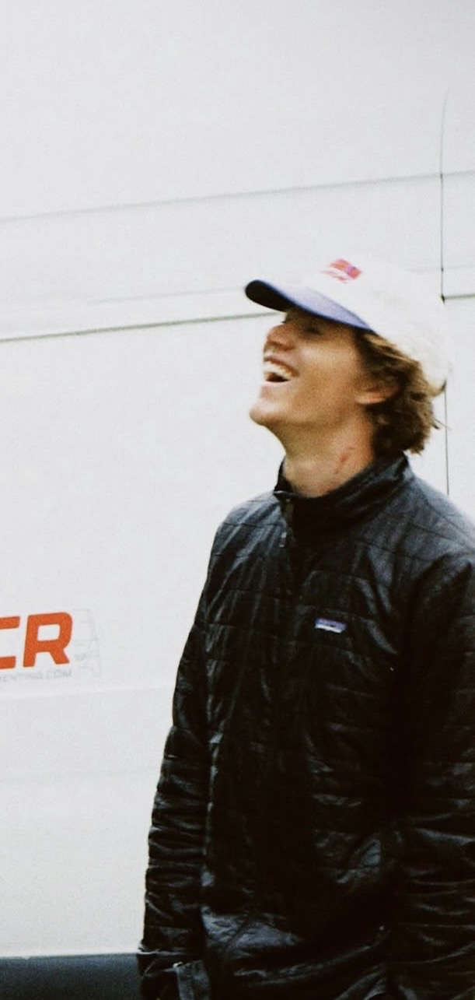

# willmalfeld.com — site guide

A static site hosted on GitHub Pages. The homepage is hand-written HTML. The writing section (`/writing/`) is generated from Markdown by a small, dependency-free Node script, and the generated pages are committed, so hosting needs no build step.

## Files

```
index.html          Home page (about, portfolio, photos, experience): edit directly
assets/home/        Homepage photos (band, projects/, album/, experience/)
content/writing/    Essays as Markdown + config.json. See content/writing/README.md
assets/writing/     Photos for each essay, one folder per essay
writing/            GENERATED essay pages, RSS feed: don't edit
sitemap.xml, robots.txt, 404.html, blog.html, blog/   GENERATED (blog URLs redirect to /writing/)
scripts/writing/    The build script
css/style.css       Site-wide styling + design tokens
css/home.css        Homepage layout
css/writing.css     Writing-section styling
js/writing.js       Filters, search, photo viewer, missing-image fallback (all pages)
tests/              `npm test`
```

## Writing

The full guide is in **[content/writing/README.md](content/writing/README.md)**. Short version:

```sh
nvm use 20          # Node 18+ needed
npm run dev         # preview at http://localhost:4000/writing/
npm run build       # regenerate pages after editing content
npm run check       # verify build is current + no broken links
npm test
```

## Homepage photos

Every photo slot on the homepage is a fixed-shape frame that crops to fit, so any photo works in any slot. Each slot currently shows a labelled placeholder that names the file it expects.

1. Export the photo as a JPG (about 2400px on the long edge; ~1600px is enough for album tiles and experience thumbnails).
2. Save it under `assets/home/`, e.g. `assets/home/album/03.jpg`.
3. In `index.html`, change the matching `.svg` to `.jpg`. Each photo appears **twice** in its block: the `<a href>` (the full-size version in the photo viewer) and the ``. Also update the `alt` text and caption.
4. Delete the placeholder `.svg` once nothing uses it.

| Section | What to edit |
|---|---|
| Portrait | `assets/will.jpg`. Tune the crop with `object-position` on the `` (x% y%). |
| Wide band under the hero | `assets/home/band.*` and its `<figcaption>` |
| Portfolio (`Currently Building`) | one `<article class="project">` per project. The first image is the large one; up to two more form a collage. For 1 image remove the `project-media--n3` class, for 2 use `project-media--n2`. Copy an `<article>` to add a project. |
| Field Album | one `<figure class="album-tile">` per photo. Tiles follow a repeating 7-photo rhythm (large, two stacked, three tall, one panorama), so add or remove tiles in groups for the tidiest layout. The `kicker` span is the label ("Teaching", "Coaching"…). |
| Experience | delete an entry's `<figure class="exp-photo">` to show it without a photo |
| Recent writing | automatic: `npm run build` fills it from your newest published essays. Don't edit between the `recent-writing` markers. |

Clicking any portfolio or album photo opens the full-screen viewer, which steps through the photos in that group. A missing or misspelled photo shows a quiet placeholder instead of a broken image, and `npm run check` reports it.

## Writing

The full guide is in **[content/writing/README.md](content/writing/README.md)**. Short version:

```sh
nvm use 20          # Node 18+ needed
npm run dev         # preview at http://localhost:4000/writing/
npm run build       # regenerate pages after editing content
npm run check       # verify build is current + no broken links
npm test
```

## Add your photo

Currently the hero uses a circular "WM" placeholder (`.portrait` in `index.html`) instead of a real photo.

1. Drop your image into the `assets/` folder, e.g. `assets/will.jpg`.
2. In `index.html`, find:
   ```html
   <div class="portrait" aria-hidden="true">WM</div>
   ```
   Replace it with:
   ```html
   
   ```
3. If the photo isn't square, add `style="object-fit:cover;"` to the `` tag so it fills the circle cleanly.

## Edit your info

Everything in `index.html` (bio, projects, experience, education, contact) is plain HTML: search for the text you want to change and edit it directly. Sections can be reordered by moving whole `<section>...</section>` blocks.

## Colors & type, if you want to adjust the look

All design tokens live at the top of `css/style.css` under `:root`. Change a hex value there and it updates everywhere:

- `--blaze` — the rust-orange accent (trail blaze)
- `--chalk` — the blue accent (teaching)
- `--contour` — the gold accent (elevation lines)
- `--ink` / `--mist` — text and background

The whole site uses the warmer paper background and the Newsreader serif from `css/writing.css` (under `body.fn`). Homepage-only layout is in `css/home.css`.
